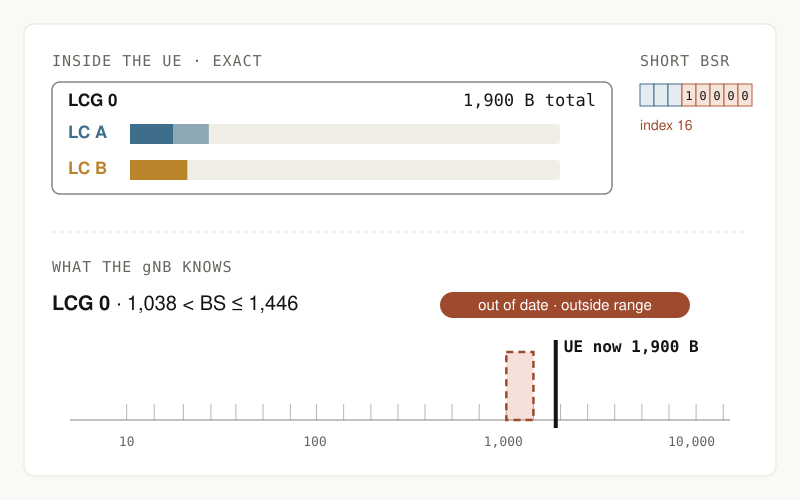

# 3GPP.studio

**3GPP, playable.** [3GPP.studio](https://3gpp.studio/) turns radio access mechanisms into interactive experiments you can explore, question and share.

Each experiment starts with a question about one mechanism. Change the inputs, follow the UE or network step by step, and see how the result changes. The goal is to help engineers, researchers and students understand how a mechanism works and why it behaves that way.

This repository brings the experiments, source code and model notes together. We welcome the 3GPP community to improve existing explanations, suggest corrections and create new experiments together.

[Explore the experiments](https://3gpp.studio/) · [Contribute](CONTRIBUTING.md)

## Try an experiment

[](https://3gpp.studio/lab/bsr/)

*In the BSR experiment, the UE has 1,900 bytes, while the gNB's last report describes a range above 1,038 and up to 1,446 bytes. Try changing the amount of later data and compare the two views.*

### [Buffer Status Reporting (BSR)](https://3gpp.studio/lab/bsr/)

How much does the gNB know about the UE's buffer? Follow a BSR from data arrival to reporting, then add more data and compare the UE's current buffer with the range the gNB last received. Change the logical channel grouping to see how the report changes.

[Model notes](prototype/lab/bsr/notes.md) · [Source](prototype/lab/bsr/)

### [Beam Failure Recovery (BFR)](https://3gpp.studio/lab/bfr/)

Do gaps between beam failure indications reset the counter? Add or remove indications, adjust the detection timer and follow what happens from failure detection to recovery.

[Model notes](prototype/lab/bfr/notes.md) · [Source](prototype/lab/bfr/)

### [cellsTriggeredList](https://3gpp.studio/lab/cells-triggered-list/)

If two neighbour cells have triggered an event but only one can be reported, which one appears in the MeasurementReport? Draw the measurements and follow the entry conditions, the list and each report over time.

[Model notes](prototype/lab/cells-triggered-list/notes.md) · [Source](prototype/lab/cells-triggered-list/)

### [Logical Channel Prioritization (LCP)](https://3gpp.studio/lab/lcp/)

How do logical channels share a smaller uplink grant? Change the grant sizes, priorities, prioritised bit rates and bucket size durations, then follow the allocation across a sequence of grants. This experiment is under technical review.

[Model notes](prototype/lab/lcp/notes.md) · [Source](source/lcp/README.md)

3GPP.studio is an independent educational project. The experiments are simplified teaching models; the notes describe their sources, assumptions and boundaries. Consult the cited 3GPP specification and version for the actual requirements.

## Run locally

No package installation is needed to serve the site. From the repository root, run:

```sh
python3 -m http.server 8767 --bind 127.0.0.1 --directory prototype
```

Open [http://127.0.0.1:8767/](http://127.0.0.1:8767/). Python 3 is needed for the local server; Node.js is needed for the model checks and the LCP page generator.

```sh
node --test tests/*.test.mjs
```

Most experiments keep their HTML, CSS, JavaScript and notes in `prototype/lab/`. Shared site assets are in `prototype/assets/`. The LCP page is generated from the editable model and drawing code in [source/lcp](source/lcp/README.md).

## Contribute

Corrections, explanations, new examples and interactive experiments are welcome. Open an issue to discuss an idea, or fork the repository and submit a pull request. The maintainer reviews proposed changes before merging them. See [CONTRIBUTING.md](CONTRIBUTING.md).

The maintainer publishes reviewed changes to the live site. A pull request merged on GitHub does not go live until the next site publication.

For maintainers, [the publishing guide](docs/publishing.md) describes how the local checkout, GitHub and the live site are synchronized.

## License and attribution

Project code is available under the [MIT License](LICENSE). Original Markdown notes and documentation are available under [CC BY 4.0](LICENSES/CC-BY-4.0.txt). See [NOTICE.md](NOTICE.md) for third-party code, specification material and trademarks.
