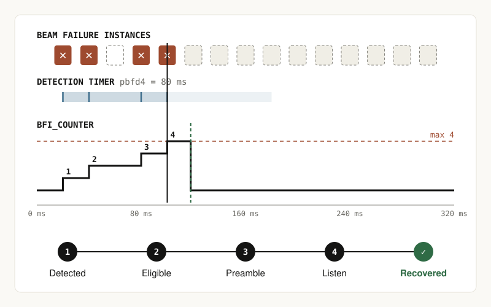

# Beam Failure Recovery (BFR): model notes

Page version: first release, 2026-11-02. Sources: 3GPP TS 38.321 V19.3.0 §5.17, §5.1.1, §5.1.2, §5.1.4. TS 38.213 V19.3.0 §6. TS 38.331 V19.3.0 (RadioLinkMonitoringConfig, BeamFailureRecoveryConfig).

## The question the page answers

When does a UE decide that its beams have failed, and what must hold for recovery to count as complete?

## Visual form

1. **Detection timeline (0–320 ms)** with three lanes:
   - the BFI slots, every illustrative 20 ms; click to toggle
   - the beamFailureDetectionTimer bars, which restart at each BFI and show where the timer expired
   - the BFI_COUNTER step plot, with a dashed max line
   
   A vertical line marks *detected → RA*, and a dashed green line marks *recovered*.
2. **Recovery gate chain**, which is active only after detection: *detected → dedicated BFR preamble eligible? → preamble sent → listen on recoverySearchSpace during ra-ResponseWindow → C-RNTI PDCCH received → recovered*. The recovery controls sit beside the chain, so each control is next to the gate it affects.

## Detection model (TS 38.321 §5.17)

- Each lower-layer BFI starts or restarts beamFailureDetectionTimer and increments BFI_COUNTER.
- When BFI_COUNTER ≥ beamFailureInstanceMaxCount on an ordinary SpCell, random access starts on the SpCell.
- Timer expiry sets BFI_COUNTER to 0. A quiet period alone does not reset it.
- Successful SpCell BFR random access sets BFI_COUNTER to 0 and stops beamFailureRecoveryTimer.
- Timer values are pbfd1–6, 8 and 10, in Qout,LR reporting periods. Max count values are n1–6, 8 and 10.
- A BFI is the lower-layer outcome "all q0 RSs worse than Qout,LR" (TS 38.213 §6). The slots are a conceptual input, not an RSRP trace. No "good" indication clears the counter.
- **Tie convention (model choice):** a BFI exactly at the timer deadline is counted first, which restarts the timer. So pbfdN tolerates up to N−1 quiet periods. The spec text does not order the two events. Ties are labelled on the timeline. *Design finding:* an earlier draft processed the expiry first. With pbfd1, that meant consecutive BFIs could never add up, which would have taught the wrong intuition, so the convention was changed.
- After detection the BFI row is frozen. Later BFIs, the later run of beamFailureDetectionTimer and any counter reset by its expiry are not simulated. The only post-detection counter change drawn is the reset on successful recovery. The no-answer and not-eligible plots therefore stop at detection instead of inventing a value.
- The two timers are distinct. beamFailureDetectionTimer (the detection lane) resets the counter on expiry. beamFailureRecoveryTimer (gate 2) only limits the use of dedicated CFRA and is stopped on success.

## Recovery model (dedicated CFRA branch only)

- §5.1.1: beamFailureRecoveryTimer, if configured, starts when this random access begins.
- §5.1.2: dedicated BFR CFRA is eligible when the recovery timer is running or not configured, the CFRA resources are configured, and a candidate SSB or CSI-RS is *above* its threshold. The MAC selects *an* eligible candidate, not necessarily the strongest. The page shows one candidate value against an illustrative −100 dBm, and equal to the threshold is not eligible. "Expired" stands for a later selection after the timer ran out.
- §5.1.4: after the preamble, the UE monitors recoverySearchSpaceId for a PDCCH addressed to C-RNTI during ra-ResponseWindow. That PDCCH completes the random access. A preamble alone, or a candidate alone, is not recovery.
- When the dedicated resources are not eligible, the page states that MAC continues with other RA resource selection, such as contention-based RA, which is not simulated. A missed response leads to normal retry handling, which is not simulated. Neither one is RLF by itself.
- Illustrative timing after detection: preamble +6 ms, window +10 to +30 ms, response +18 ms.

## Key states (presets)

| Preset | Inputs | Result |
|---|---|---|
| Detected despite a gap | BFI 20, 40, 80, 100. pbfd4 (80 ms), n4 | counts 1–4. 60 ms quiet with no reset. Detected at 100 ms, recovered at 118 ms |
| Counter reset | BFI 20, 40, 160 | expiry at 120 ms resets 2→0. BFI at 160 counts 1. Expiry at 240 ms. Not detected |
| Sparse failures | BFI every 40 ms, pbfd1 (20 ms), n3 | the counter never exceeds 1 |
| Candidate too weak | −105 dBm vs −100 dBm | detected, dedicated path not eligible, fallback named |
| Preamble sent, no answer | response missed | detected, preamble sent, not recovered |

## Scope boundaries

SCell BFR (BFR MAC CE and SR), PSCell with a deactivated SCG, two-TRP BFD-RS sets, NTN, DRX, CBRA fallback, preamble retransmission, power ramping and back-off are not modelled. BFR is not handover, and BFI is not RLF.

## Tests

`node tests/bfr-model.test.mjs` runs 11 checks. They cover the walkthrough, the counterexample, sparse BFIs, pbfd1 consecutive BFIs, the tie convention, the BFIs ignored after detection, every recovery gate outcome (including threshold equality) and a 9,408-combination sweep. `node tests/page-smoke.test.mjs` runs the page script against a DOM stub, not a browser.

## Preview

Generated from the model by `node tools/make-previews.mjs`. It shows the default walkthrough.

## Review fixes (2026-11-02, after Codex browser check)

Marker labels now sit in a reserved strip above the lanes: detection on row 1, recovery on row 2, with labels flipped to the left of their line beyond 70 % of the axis. The final tick reads `320 ms`, which removes the separate `ms` label that overlapped it. Below 760 px a cue says the timeline scrolls sideways, and the scroll region is keyboard-focusable with an accessible name. The takeaway no longer implies that success is the only counter reset.
