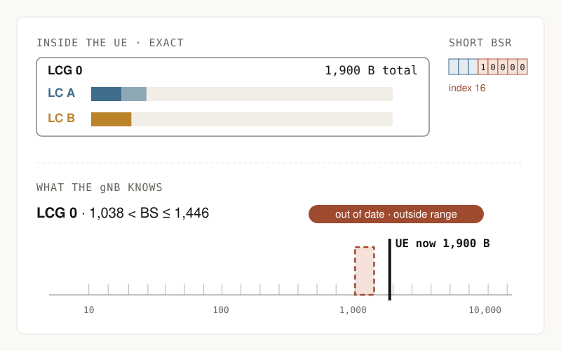

# Buffer Status Reporting (BSR): model notes

Page version: explainer redesign, 2026-11-02 (it replaces the Anatomy "dual-queue bench" page). Source: 3GPP TS 38.321 V19.3.0, §5.4.5 and §6.1.3.1, Tables 6.1.3.1-1 and 6.1.3.1-2.

## The question the page answers

After a BSR is sent, what does the gNB actually know about the UE's buffer, and when does that knowledge go out of date?

## Visual form

- **Five moments** across the top: data arrives, PDU built, gNB receives the BSR, more data arrives, next BSR. Each one has a one-sentence explanation.
- **Inside the UE:** exact byte bars for LC A and LC B, drawn inside their LCG box(es). The grouping toggle redraws the boxes. This is what makes aggregation visible.
- **On the air:** the real MAC CE octets. Short BSR is 3-bit LCG ID plus 5-bit index. Long BSR is a bitmap octet plus one 8-bit index octet per reported LCG.
- **What the gNB knows:** one log-scale ruler per reported field. It shows table boundaries as ticks, the reported range as a band and the UE's actual bytes as a black marker. The tag separates two states. *Out of date* means the queue changed since the report was built. *Outside* means the actual value left the reported range. A small change can make a report out of date while it still looks correct (Codex review, 2026-11-02).

## Model

- Two logical channels, A and B, either both in LCG 0 or in LCG 0 and LCG 1. This is ordinary NR, without IAB or additionalBS-TableAllowed.
- Initial data arrives into empty buffers, which triggers a Regular BSR. No UL-SCH resource is available, so an SR is sent. The SR carries no byte count.
- The grant's payload (after control and headers, not TBS) is taken from A first, then B. This is a constructed order, not full LCP.
- **Format** is decided from the LCGs that have data *when the PDU is to be built*. More than one gives Long, otherwise Short. **Field values** are the bytes left *after* the PDU is assembled. A group that this PDU empties is therefore listed in a Long BSR with index 0.
- A Short BSR with every group empty is drawn as LCG 0, index 0.
- Index *i* means `bounds[i−1] < BS ≤ bounds[i]`, using the exact table values (`prototype/assets/anatomy/bsr-tables.mjs`). Index 0 means BS = 0.
- Separate groups produce a Long BSR only when more than one LCG has data at PDU build time. Configuring two groups alone does not force Long.
- Moment 4 adds the later arrival to A. The gNB keeps the moment-3 report. If the relevant buffers were empty, the page states that a new Regular BSR is triggered. SR and grant handling for it are not drawn.
- Moment 5 assumes a later reporting opportunity, such as a periodic BSR, with no further service.

## Worked example (default)

A = 1,200 B, B = 800 B and 600 B served from A, which leaves A = 600 B and B = 800 B.

- Shared LCG 0: Short, index 16, (1,038, 1,446] B. This contains 1,400 B.
- Separate LCGs: Long, 3 octets. LCG 0 is index 66, (597, 635] B. LCG 1 is index 70, (767, 817] B.
- Then 500 B arrive on A. In the shared case the UE has 1,900 B, outside the stale range. The next Short is index 17, (1,446, 2,014] B.

## Presets

Baseline (outside the range at moment 4) · Separate groups (Long 66/70) · Change within one range (+40 B: 1,440 B is still in (1,038, 1,446], so the report is out of date but in range, and the refresh reports index 16 again) · Drain one group (Long with LCG 0 index 0) · Everything sent (Short index 0, then the retrigger) · Big buffer, coarse range (8,000 B gives Short (7,587, 10,570]).

## Limits

Timer state machines, Padding, Truncated, Refined and Extended BSR, HARQ, real scheduling and SR timing are not simulated. MAC CE sizes exclude the subheader. Bars use a fixed 0–6,000 B scale. The ruler spans 5–16,000 B on a log scale. Byte inputs already count as BSR-accounted volume.

## Tests

`node tests/bsr-model.test.mjs` checks the walkthrough values, the table edges, the drained-LCG counterexample, the retrigger condition and a 288-combination sweep, plus the within-range out-of-date case. `node tests/page-smoke.test.mjs` runs the page script against a DOM stub. It is not a browser test.

## Preview

Generated from the model by `node tools/make-previews.mjs`. It shows the shared-LCG baseline at moment 4.

## Review fixes (2026-11-02, after Codex browser check)

Ruler classes are scoped (`r-band`, `r-act`), so the legend swatch no longer escapes into the nav. The actual-byte label moved above the track and flips its anchor near either edge, which avoids the decade labels at 390 px. The on-air heading follows the moment: *Scheduling request*, *BSR MAC CE* or *nothing new*. Out-of-date and outside-range are separate states. The Long-format takeaway is qualified.
